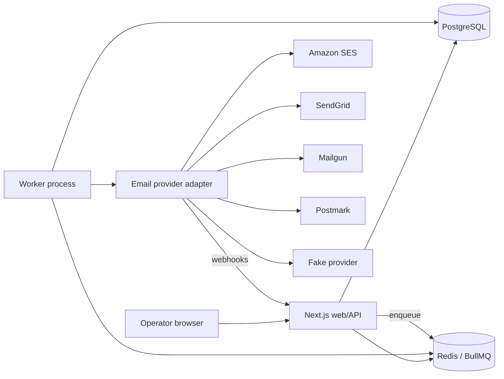
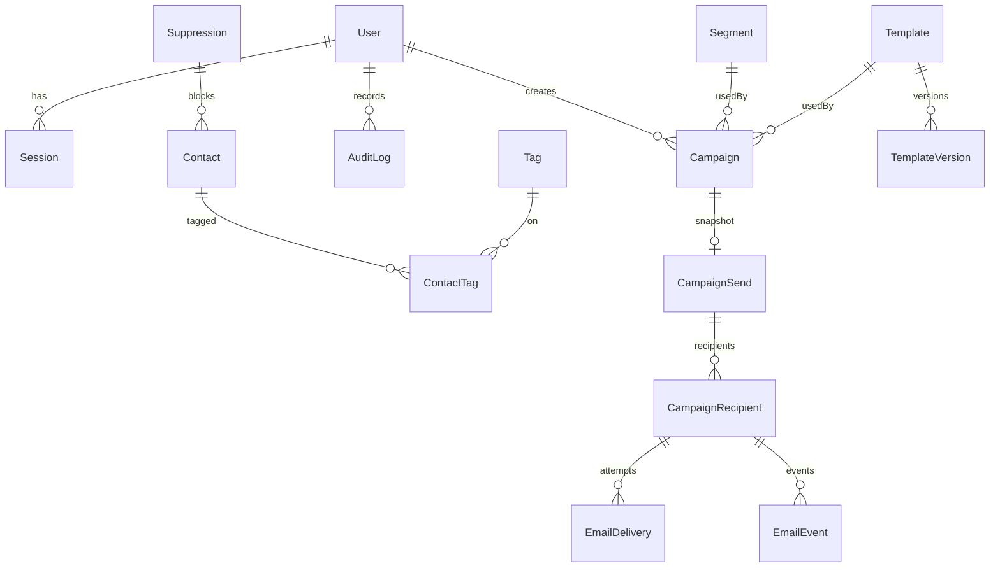
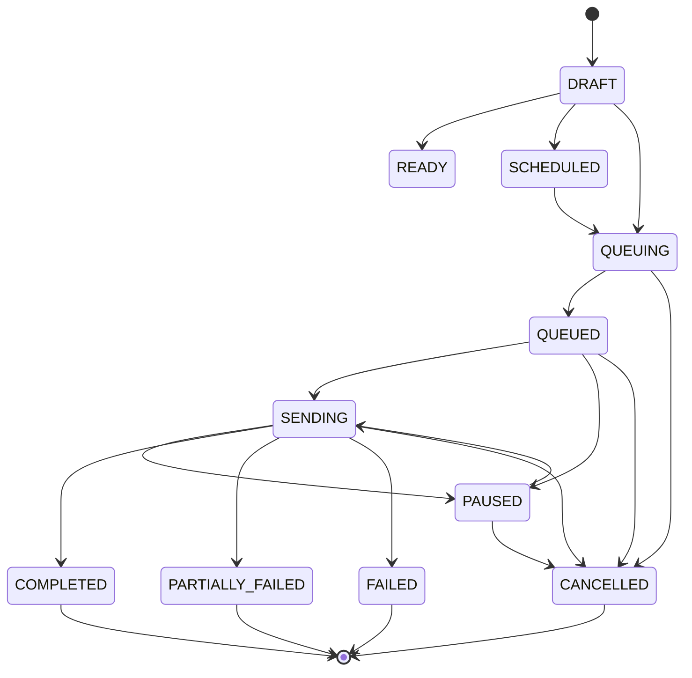
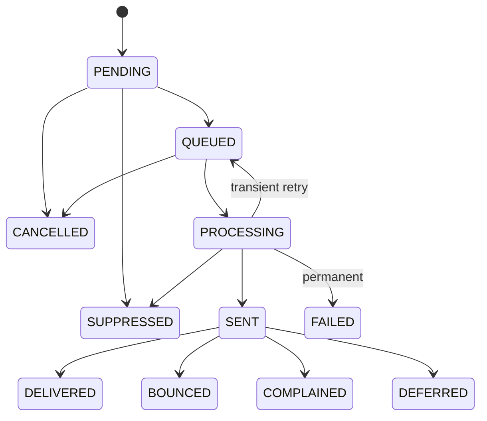
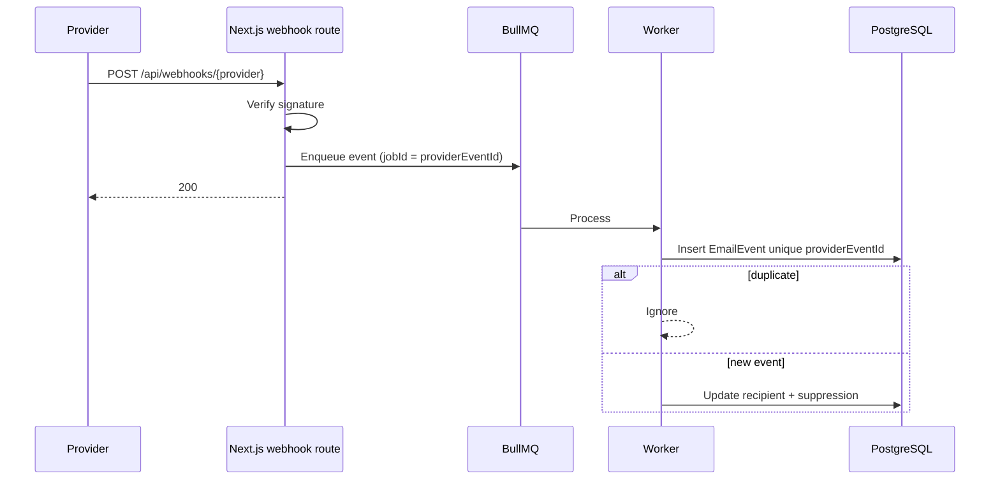

# ENG Email Automation — Architecture

Internal, single-organization email campaign platform. Not a SaaS product. PostgreSQL is the source of truth. Redis/BullMQ are reconstructable queues.

## 1. System architecture



The UI never sends bulk mail. "Send" creates an immutable `CampaignSend` snapshot, writes `CampaignRecipient` rows in the worker, and enqueues delivery jobs.

## 2. Database ER diagram



## 3. Campaign state machine



## 4. Email delivery state machine



## 5. Queue architecture

Queues:

- `campaign-materialize` — resolve audience in batches of `EMAIL_BATCH_SIZE`
- `email-send` — one job per recipient, `jobId = idempotencyKey`, concurrency + per-second limiter
- `csv-import` — stream CSV from disk
- `provider-webhook` — verified events
- `campaign-scheduled` — delayed start
- `campaign-reconcile` — repeatable; rebuilds missing jobs from Postgres

Worker limiter: `EMAIL_RATE_LIMIT_PER_SECOND` / 1000ms. Scaling workers multiplies throughput; size to the provider quota, never above it.

## 6. Provider webhook flow



## 7. Idempotency strategy

- Send API: unique `CampaignSend.campaignId` and unique `idempotencyKey`. Repeat POST returns the existing send.
- Recipient: unique `(campaignSendId, emailNormalized)` and unique `idempotencyKey`.
- BullMQ `jobId = idempotencyKey` so Redis reconnects do not create a second job.
- Worker claims with `UPDATE ... WHERE status IN (QUEUED, PENDING, FAILED)`.
- Terminal statuses (`SENT`, `DELIVERED`, ...) are never resent, including after pause/resume or worker crash.
- Webhooks: unique `providerEventId`.

## 8. Failure / recovery

| Failure | Response |
| --- | --- |
| Redis down | HTTP send still writes CampaignSend; reconcile requeues from Postgres |
| Postgres down | API/worker fail closed; no send without durable recipient rows |
| Provider timeout/throttle | Transient retry with exponential backoff + jitter; throttle adds extra delay |
| Worker crash | In-flight PROCESSING rows are requeued after `STUCK_PROCESSING_MS` |
| Duplicate webhook | Unique event id, no second suppression/status write |
| Malformed CSV | Row counted invalid; job continues |
| Partial completion | Campaign `PARTIALLY_FAILED`; remaining eligible rows stay queryable |

## 9. Security model

- No public registration. Admin-created users only.
- Roles: Admin > Operator > Viewer.
- HttpOnly session cookies, hashed tokens in Postgres, login rate limits.
- CSRF origin check on mutating API requests.
- Webhook signature verification per provider.
- HMAC unsubscribe tokens (no sequential ids).
- Secrets never sent to the browser or written to logs.
- Templates interpolate escaped variables only.

## 10. Project directory structure

```
src/app/(app)          Authenticated pages
src/app/api            Route handlers
src/app/unsubscribe    Public unsubscribe
src/components         App shell + shadcn/ui
src/lib/auth.ts        Sessions
src/lib/campaigns      Send snapshot, audience, pause/resume
src/lib/email          Provider adapters, render, webhooks
src/lib/queue          BullMQ
src/worker             Dedicated worker process
prisma                 Schema + migrations
tests                  Unit tests
scripts/load-test.ts   Fake-provider 30k harness
```
